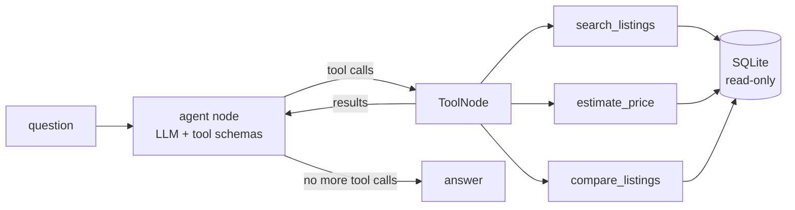

# car-agent-harness

[](https://github.com/yogesh660/car-agent-harness/actions/workflows/ci.yml)

A LangGraph agent for a used-car marketplace, built in a repo that is set up for coding agents
to work in safely.

```
$ car-agent ask --trace "Seller wants 18,500 for a 2019 VW Golf with 60k km. Fair price?"
[tool] estimate_price {"make": "Volkswagen", "model": "Golf", "year": 2019, "mileage_km": 60000, "asking_price_eur": 18500}
...
```

There are two parts to this project:

1. **The agent.** Search listings, estimate market prices from comparable cars, compare listings.
2. **The harness.** Everything that lets a coding agent (Claude Code, Codex, Copilot) change the
   code without breaking it: `CLAUDE.md`, one-command workflows, tests that check the repo
   itself, an eval set with a pass/fail gate, CI.

## How it works



- `src/car_agent/tools/` - tools as plain functions with pydantic input/output models
  ([ADR 0002](docs/adr/0002-framework-free-tools.md))
- `src/car_agent/agent/` - hand-written LangGraph loop with a step budget
  ([ADR 0001](docs/adr/0001-explicit-langgraph-graph.md))
- `evals/` - question -> expected tool calls, scored per case

Price estimates use the median of comparable listings (same model, similar year and mileage),
loosening the match until there are at least 5 cars, and report the 25th-75th percentile band.

## Quickstart

```bash
git clone https://github.com/yogesh660/car-agent-harness && cd car-agent-harness
python -m venv .venv && source .venv/bin/activate
make setup        # installs package + dev tools + pre-commit hook
make check        # lint, mypy, tests. no model or API key needed
make seed         # builds data/listings.db
```

## Choosing a model

The model is set with `CAR_AGENT_MODEL="<provider>:<model>"`. Install the matching extra.

| Setup | Install | Env |
|---|---|---|
| Local, free (Ollama) | `pip install -e ".[ollama]"`, `ollama pull qwen2.5:7b` | default |
| OpenAI | `pip install -e ".[openai]"` | `CAR_AGENT_MODEL=openai:gpt-4o-mini`, `OPENAI_API_KEY` |
| Anthropic | `pip install -e ".[anthropic]"` | `CAR_AGENT_MODEL=anthropic:<model>`, `ANTHROPIC_API_KEY` |
| vLLM server | `pip install -e ".[openai]"` | `CAR_AGENT_MODEL=openai:<served model>`, `CAR_AGENT_BASE_URL=http://host:8000/v1`, `OPENAI_API_KEY=x` |

Then:

```bash
make ask Q="Any automatic SUVs from 2020 or newer under 30k?"
make eval
```

## The harness

| Piece | Where | What it does |
|---|---|---|
| Agent instructions | [`CLAUDE.md`](CLAUDE.md), [`AGENTS.md`](AGENTS.md) | layout, commands, rules, definition of done |
| One way to run things | [`Makefile`](Makefile) | same commands for people, agents and CI |
| Repo self-checks | [`tests/test_harness.py`](tests/test_harness.py) | docs only mention real commands, every tool has a test file, every tool argument is described for the model, eval cases are valid |
| Offline agent tests | [`tests/agent/`](tests/agent) | graph tested with a scripted fake model: tool routing, error recovery, step budget |
| Evals | [`evals/`](evals) | 13 ground-truth cases, pass/fail per case, exits non-zero below a threshold |
| Guardrails | `pre-commit`, mypy strict, ruff, read-only DB, parameterised SQL | catch mistakes before review |
| Decisions | [`docs/adr/`](docs/adr) | why, so an agent doesn't "fix" a deliberate choice |
| Task format | [`.github/ISSUE_TEMPLATE/agent_task.md`](.github/ISSUE_TEMPLATE/agent_task.md) | issues scoped so an agent can do them without questions |

## Roadmap

- [x] Agent with 3 tools, tests, CI, CLAUDE.md, eval set
- [ ] Run evals in CI against a hosted model, track pass rate over time
- [ ] RAG over car specs and reviews (pgvector)
- [ ] Knowledge graph of makes/models/engines for graph-based retrieval
- [ ] FastAPI service + Streamlit chat UI with a tool-call trace view
- [ ] Docker image, Helm chart for Kubernetes
- [ ] Tracing (Langfuse / OpenTelemetry), drift and hallucination checks
- [ ] Fine-tuned small model for query-to-filter extraction vs. prompting
- [ ] Changes made by coding agents from issues, linked here with what CI caught

## Data

The listings are synthetic: 2,500 cars generated with a fixed seed, see
[ADR 0003](docs/adr/0003-synthetic-seeded-data.md). Prices are plausible, not real.

## License

MIT
