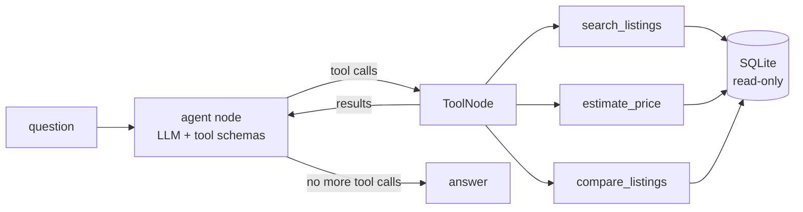

# car-agent-harness

[](https://github.com/yogesh660/car-agent-harness/actions/workflows/ci.yml)
[](https://github.com/yogesh660/car-agent-harness/actions/workflows/eval.yml)

A LangGraph agent for a used-car marketplace, built in a repo that is set up for coding agents
to work in safely.

```
$ car-agent ask --trace "Seller wants 18,500 for a 2019 VW Golf with 60k km. Fair price?"
[tool] estimate_price {"make": "Volkswagen", "model": "Golf", "year": 2019, "mileage_km": 60000, "asking_price_eur": 18500}
...
```

There are two parts to this project:

1. **The agent.** Search listings, estimate market prices from comparable cars, compare listings.
2. **The harness.** Everything that lets a coding agent (Claude Code, Codex, Copilot) change the
   code without breaking it: `CLAUDE.md`, one-command workflows, tests that check the repo
   itself, an eval set with a pass/fail gate, CI.

## How it works



- `src/car_agent/tools/` - tools as plain functions with pydantic input/output models
  ([ADR 0002](docs/adr/0002-framework-free-tools.md))
- `src/car_agent/agent/` - hand-written LangGraph loop with a step budget
  ([ADR 0001](docs/adr/0001-explicit-langgraph-graph.md))
- `evals/` - 56 ground-truth cases, scored on tool use and answer grounding
  ([ADR 0004](docs/adr/0004-eval-design.md))

Price estimates use the median of comparable listings (same model, similar year and mileage),
loosening the match until there are at least 5 cars, and report the 25th-75th percentile band.

## Quickstart

Needs [uv](https://docs.astral.sh/uv/) (it installs the right Python by itself).

```bash
git clone https://github.com/yogesh660/car-agent-harness && cd car-agent-harness
make setup        # uv sync: package, model providers, MLflow, dev tools + pre-commit hook
make check        # lint, mypy, tests. no model or API key needed
make seed         # builds data/listings.db
```

## Choosing a model

The model is set with `CAR_AGENT_MODEL="<provider>:<model>"`. `make setup` installs every
provider; with plain uv, add the matching extra (`uv sync --extra ollama`).

| Setup | Env |
|---|---|
| Local, free (Ollama): `ollama pull qwen2.5:7b` | default, nothing to set |
| OpenAI | `CAR_AGENT_MODEL=openai:gpt-4o-mini`, `OPENAI_API_KEY` |
| Anthropic | `CAR_AGENT_MODEL=anthropic:<model>`, `ANTHROPIC_API_KEY` |
| vLLM or any OpenAI-compatible server | `CAR_AGENT_MODEL=openai:<served model>`, `CAR_AGENT_BASE_URL=http://host:8000/v1`, `OPENAI_API_KEY` |

Then:

```bash
make ask Q="Any automatic SUVs from 2020 or newer under 30k?"
make eval-smoke                         # 13 cases, a few minutes on a laptop
make eval EVAL_ARGS="--judge --mlflow"  # all 56 cases + LLM judge, logged to MLflow
make mlflow                             # compare runs at http://localhost:5000
```

## Evaluation

Every case is scored three ways ([ADR 0004](docs/adr/0004-eval-design.md)):

| Check | Question it answers | Cost |
|---|---|---|
| Tool calls | right tools, right arguments, right listing in the answer? | free, every case |
| Number grounding | is every price, mileage and id in the answer backed by a tool result? | free, every case |
| LLM-as-judge | are verdicts and other claims supported? | one extra model call, `--judge` |

Cases are grouped by capability: search, complex filters, normalisation (VW, München, "station
wagon"), price, compare, multi-step, not found, vague requests and out-of-scope questions.

In CI, [`eval.yml`](.github/workflows/eval.yml) runs the smoke set on PRs that change the agent
and the full set nightly. It uses a hosted model when the `EVAL_API_KEY` secret is set, and
otherwise Ollama on the runner's CPU, so it works without any paid key. A run fails when the
pass rate or grounded rate drops more than 5 points below the accepted scores in
`evals/baseline.json`; a failed nightly run opens an issue.

## The harness

| Piece | Where | What it does |
|---|---|---|
| Agent instructions | [`CLAUDE.md`](CLAUDE.md), [`AGENTS.md`](AGENTS.md) | layout, commands, rules, definition of done |
| One way to run things | [`Makefile`](Makefile) | same commands for people, agents and CI |
| Repo self-checks | [`tests/test_harness.py`](tests/test_harness.py) | docs only mention real commands, every tool has a test file, every tool argument is described for the model, every tool has eval cases, eval cases reference real listings |
| Offline agent tests | [`tests/agent/`](tests/agent) | graph and eval runner tested with a scripted fake model: tool routing, error recovery, step budget, scoring |
| Evals | [`evals/`](evals) | 56 ground-truth cases, grounding check, LLM judge, baseline gate in CI, MLflow history |
| Guardrails | `pre-commit`, mypy strict, ruff, read-only DB, parameterised SQL | catch mistakes before review |
| Decisions | [`docs/adr/`](docs/adr) | why, so an agent doesn't "fix" a deliberate choice |
| Task format | [`.github/ISSUE_TEMPLATE/agent_task.md`](.github/ISSUE_TEMPLATE/agent_task.md) | issues scoped so an agent can do them without questions |

## Roadmap

Full plan with stack choices and CI/CD design: [docs/ROADMAP.md](docs/ROADMAP.md).

- [x] **M0** Agent with 3 tools, tests, CI, CLAUDE.md, eval set
- [x] **M1** Measured agent: 56 eval cases, grounding check, LLM-as-judge, MLflow tracking, nightly eval gate (baselines pending)
- [ ] **M2** Knowledge: Postgres + pgvector RAG, Neo4j knowledge graph, retrieval evals
- [ ] **M3** Service: FastAPI, Streamlit trace UI, Docker images on GHCR
- [ ] **M4** Kubernetes: Helm chart, vLLM, autoscaling, Grafana dashboards
- [ ] **M5** Own model: LoRA fine-tune for query-to-filter, MLflow registry, gated promotion
- [ ] **M6** Production monitoring: tracing, hallucination and drift checks
- [ ] **M7** Coding agents working on this repo from issues, with results tracked

## Data

The listings are synthetic: 2,500 cars generated with a fixed seed, see
[ADR 0003](docs/adr/0003-synthetic-seeded-data.md). Prices are plausible, not real.

## License

MIT
