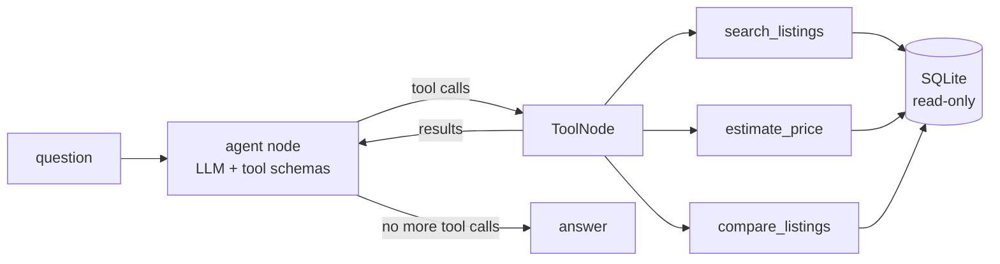
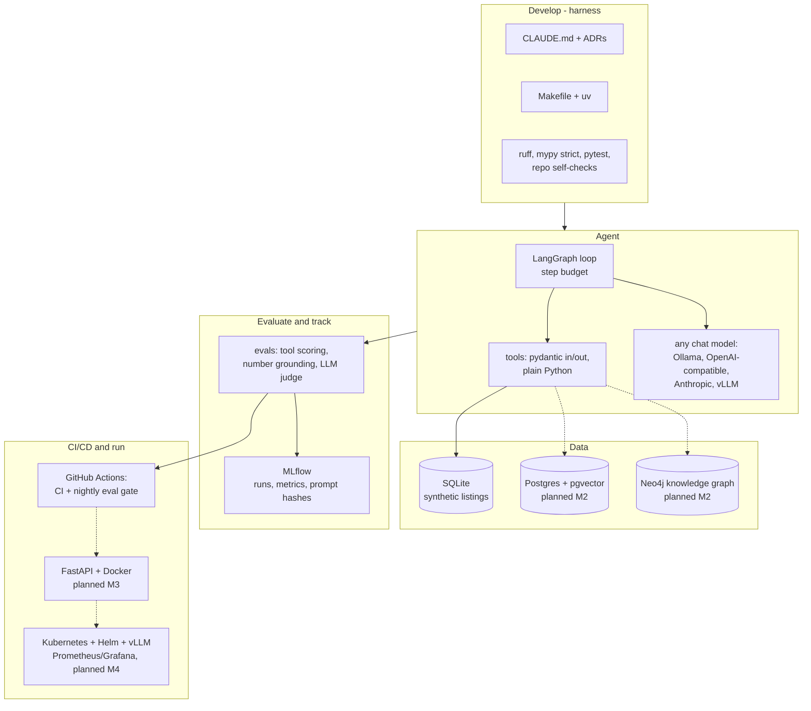

# car-agent-harness

[](https://github.com/yogesh660/car-agent-harness/actions/workflows/ci.yml)
[](https://github.com/yogesh660/car-agent-harness/actions/workflows/eval.yml)

**Case study page:** [yogesh660.github.io/car-agent-harness](https://yogesh660.github.io/car-agent-harness/)

A LangGraph agent for a used-car marketplace, built in a repo that is set up for coding agents
to work in safely.

**In 30 seconds:** buyers ask in plain language; the agent answers only through tools that query
the listings data, so it can't invent cars or prices. Every change to the agent is measured
against 56 ground-truth questions, including a check that every number in an answer came from
the data. The repo is built so a coding agent can change it and prove it didn't make things worse.

```
$ car-agent ask --trace "Seller wants 18,500 for a 2019 VW Golf with 60k km. Fair price?"
[tool] estimate_price {"make": "Volkswagen", "model": "Golf", "year": 2019, "mileage_km": 60000, "asking_price_eur": 18500}
...
```

## The problem

People shopping for a used car think in sentences: "a diesel estate under 15,000 with low
mileage near Munich", "is this one overpriced?", "which of these two is the better buy?".
Marketplace search makes them translate that into a dozen filters, and price judgement is
left to gut feeling.

An LLM chat assistant looks like the obvious fix, but it creates two new problems:

1. **It makes things up.** A model that invents a listing, a price or a "fair deal" verdict is
   worse than no assistant, because the buyer acts on it. A marketplace can't ship that.
2. **It's hard to change safely.** Prompts, tool descriptions and models change all the time,
   more and more often through coding agents (Claude Code, Codex, Copilot). Without a way to
   measure the agent, every change is a guess, and nobody notices when quality drops.

## How this project solves it

**An agent that can only answer from data.** The LLM never answers from memory. It turns the
question into calls to three tools that read the listings database: `search_listings`,
`estimate_price` (median of comparable cars, with a below/fair/above-market verdict) and
`compare_listings`. Tools have strict, typed inputs, reject anything they don't understand,
and run on a read-only connection.

**Evaluation that catches the failures that matter.** 56 ground-truth questions check that the
right tools were called with the right arguments, and that every price, mileage and listing
id in the answer actually came from a tool result. The evals run on every agent change and
nightly, and block a change that makes the agent worse.

**A repo built for coding agents.** `CLAUDE.md`, one-command workflows, decision records and
tests that check the repo itself, so a coding agent can make a change, prove it didn't break
anything, and open a PR a human can review quickly. This is the "harness".

## Design principles

1. **Models propose, code decides.** The LLM picks which tool to call and how to phrase the
   answer. Facts (listings, prices, verdicts) come only from deterministic, tested code.
2. **Measure before you change.** No prompt, tool or model change goes in on a hunch; the eval
   set says whether it helped. A prompt tweak that looked like a fix but lowered tool accuracy
   was reverted (see [findings](#what-the-evals-found-so-far)).
3. **Fail loudly.** Unknown tool arguments are rejected, not ignored; invalid answers fail the
   eval; a nightly regression opens an issue.
4. **Portable by default.** The model is an environment variable, the database a connection
   string, the service a container. Cloud choice stays a cost decision, not a rewrite.
5. **Legible to agents and people.** One way to run everything (`make`), written rules
   (`CLAUDE.md`), recorded decisions (`docs/adr/`), and tests that check the repo itself.

### Trade-offs and what's out of scope

- **Synthetic data.** 2,500 generated listings keep the repo self-contained and the evals
  stable; real data is a loader away ([ADR 0003](docs/adr/0003-synthetic-seeded-data.md)).
- **Strict tool-call scoring.** A different but reasonable filter counts as a failure. Accepted
  for stable, explainable numbers; the LLM judge covers nuance.
- **Small local model as the baseline.** Qwen 2.5 7B on a CPU is free to run every night and
  shows real failure modes; bigger models are one variable away.
- **Not a product.** No accounts, payments or real listings. The point is the engineering:
  grounding, evaluation and a repo that agents can work in safely.

## How it works



- `src/car_agent/tools/` - tools as plain functions with pydantic input/output models
  ([ADR 0002](docs/adr/0002-framework-free-tools.md))
- `src/car_agent/agent/` - hand-written LangGraph loop with a step budget
  ([ADR 0001](docs/adr/0001-explicit-langgraph-graph.md))
- `evals/` - 56 ground-truth cases, scored on tool use and answer grounding
  ([ADR 0004](docs/adr/0004-eval-design.md))

Price estimates use the median of comparable listings (same model, similar year and mileage),
loosening the match until there are at least 5 cars, and report the 25th-75th percentile band.

## Tech stack

Built now (M0-M1) and planned (M2-M7, see the [roadmap](docs/ROADMAP.md)):



| Layer | Choice | Why this |
|---|---|---|
| Agent framework | **LangGraph**, graph written by hand | explicit nodes and a step budget; every step can be tested and traced ([ADR 0001](docs/adr/0001-explicit-langgraph-graph.md)) |
| Tools | **plain Python + pydantic** | business logic doesn't depend on an agent framework; typed schemas are what the model sees ([ADR 0002](docs/adr/0002-framework-free-tools.md)) |
| Model access | **LangChain chat models** (Ollama, OpenAI-compatible, Anthropic) | swap models with one environment variable; vLLM or any hosted API works without code changes |
| Data | **SQLite** now, **Postgres + pgvector** next | zero setup for development and tests; Postgres adds vector search for RAG without running a separate vector database |
| Knowledge graph (M2) | **Neo4j** | makes, models, engines and known issues are naturally a graph; graph-based retrieval is a listed requirement in many GenAI roles |
| Evaluation | own runner: tool scoring + **number grounding** + optional **LLM-as-judge** | the cheap deterministic checks run on every change; the judge covers what rules can't ([ADR 0004](docs/adr/0004-eval-design.md)) |
| Experiment tracking | **MLflow** | one tool for eval runs now and fine-tuning runs and the model registry later |
| Packaging | **uv** | fast, reproducible installs; the same commands locally and in CI |
| Code quality | **ruff, mypy (strict), pytest, pre-commit** | catches mistakes before review, whoever wrote the code |
| CI/CD | **GitHub Actions** | CI on every push; evals on agent changes and nightly with a regression gate |
| Serving (M3-M4) | **FastAPI, Docker, Helm on Kubernetes, vLLM** | standard, portable deployment that runs on a laptop (kind) or any cloud |
| Monitoring (M4-M6) | **Prometheus, Grafana, OpenTelemetry traces in MLflow** | latency, cost per query, tool errors, hallucination and drift checks |

### Running it on GCP, AWS or Azure

Everything above is open source and runs anywhere Kubernetes runs. If a team prefers managed
services, these are the closest equivalents:

| Need | Open-source default | Google Cloud | AWS | Azure |
|---|---|---|---|---|
| LLM | vLLM on Kubernetes | Gemini models or vLLM on Vertex AI / Gemini Enterprise Agent Platform | Amazon Bedrock, or vLLM on SageMaker AI endpoints | Azure OpenAI / models in Microsoft Foundry |
| Agent runtime | FastAPI + LangGraph in a container | Vertex AI Agent Engine, or Cloud Run | Amazon Bedrock AgentCore Runtime, or ECS on Fargate | Foundry Agent Service, or Azure Container Apps |
| Listings + vectors | Postgres + pgvector | Cloud SQL for PostgreSQL or AlloyDB (pgvector) | Amazon RDS / Aurora PostgreSQL (pgvector) | Azure Database for PostgreSQL flexible server (pgvector) |
| Knowledge graph | Neo4j | Neo4j AuraDB (marketplace) or Spanner Graph | Amazon Neptune, or Neo4j AuraDB | Neo4j AuraDB (marketplace) or Cosmos DB for Apache Gremlin |
| Experiment tracking | MLflow | Vertex AI Experiments, or MLflow on GKE | SageMaker AI managed MLflow | Azure Machine Learning (MLflow-compatible tracking) |
| Containers | Docker images on GHCR | Artifact Registry | Amazon ECR | Azure Container Registry |
| Kubernetes | Helm chart (kind locally) | GKE | Amazon EKS | AKS |
| Monitoring | Prometheus + Grafana | Managed Service for Prometheus, Cloud Monitoring | Amazon Managed Prometheus + Managed Grafana, CloudWatch | Azure Monitor managed Prometheus + Azure Managed Grafana |
| Secrets | GitHub secrets, Kubernetes secrets | Secret Manager | AWS Secrets Manager | Azure Key Vault |
| CI/CD | GitHub Actions | GitHub Actions or Cloud Build | GitHub Actions or CodePipeline/CodeBuild | GitHub Actions or Azure Pipelines |

The code doesn't change between these: the model is an environment variable, the database is
a connection string, and the deployment is a container. That is deliberate, so the choice of
cloud stays a cost and operations decision.

## Quickstart

Needs [uv](https://docs.astral.sh/uv/) (it installs the right Python by itself).

```bash
git clone https://github.com/yogesh660/car-agent-harness && cd car-agent-harness
make setup        # uv sync: package, model providers, MLflow, dev tools + pre-commit hook
make check        # lint, mypy, tests. no model or API key needed
make seed         # builds data/listings.db
```

## Choosing a model

The model is set with `CAR_AGENT_MODEL="<provider>:<model>"`. `make setup` installs every
provider; with plain uv, add the matching extra (`uv sync --extra ollama`).

| Setup | Env |
|---|---|
| Local, free (Ollama): `ollama pull qwen2.5:7b` | default, nothing to set |
| OpenAI | `CAR_AGENT_MODEL=openai:gpt-4o-mini`, `OPENAI_API_KEY` |
| Anthropic | `CAR_AGENT_MODEL=anthropic:<model>`, `ANTHROPIC_API_KEY` |
| vLLM or any OpenAI-compatible server | `CAR_AGENT_MODEL=openai:<served model>`, `CAR_AGENT_BASE_URL=http://host:8000/v1`, `OPENAI_API_KEY` |

Then:

```bash
make ask Q="Any automatic SUVs from 2020 or newer under 30k?"
make eval-smoke                         # 13 cases, a few minutes on a laptop
make eval EVAL_ARGS="--judge --mlflow"  # all 56 cases + LLM judge, logged to MLflow
make mlflow                             # compare runs at http://localhost:5000
```

## Evaluation

Every case is scored three ways ([ADR 0004](docs/adr/0004-eval-design.md)):

| Check | Question it answers | Cost |
|---|---|---|
| Tool calls | right tools, right arguments, right listing in the answer? | free, every case |
| Number grounding | is every price, mileage and id in the answer backed by a tool result? | free, every case |
| LLM-as-judge | are verdicts and other claims supported? | one extra model call, `--judge` |

Cases are grouped by capability: search, complex filters, normalisation (VW, München, "station
wagon"), price, compare, multi-step, not found, vague requests and out-of-scope questions.

In CI, [`eval.yml`](.github/workflows/eval.yml) runs the smoke set on PRs that change the agent
and the full set nightly. It uses a hosted model when the `EVAL_API_KEY` secret is set, and
otherwise Ollama on the runner's CPU, so it works without any paid key. A run fails when the
pass rate or grounded rate drops more than 5 points below the accepted scores in
[`evals/baseline.json`](evals/baseline.json); a failed nightly run opens an issue.

### Current results

Qwen 2.5 7B via Ollama on a GitHub Actions CPU runner, temperature 0 (results were identical
across three runs).

| Suite | Pass | Right tools | Right args | Grounded |
|---|---|---|---|---|
| smoke (13 cases) | 69% | 100% | 85% | 100% |
| full (56 cases) | first nightly run pending | | | |

### What the evals found so far

- **Silently ignored arguments.** The model called `search_listings` with `year=2020`, which
  isn't an argument. Pydantic dropped it without an error, so the model believed it had
  filtered by year. Tool inputs now reject unknown arguments, and the model retries with
  `min_year`. A repo self-check keeps it that way.
- **Invented filters.** For "automatic SUV, 2020 or newer, max 30k" the model adds
  `make=Volkswagen, model=Tiguan`, which the user never asked for. Still failing.
- **Dropped asking price.** "Seller wants 18,500 ... fair price?" gets an estimate but no
  verdict, because the asking price isn't passed on. Still failing.
- **Prompt rules are not free.** Adding rules for the two issues above fixed the asking price
  but made the model skip the price tool on another case, so tool accuracy fell from 100% to
  92%. The change was reverted. Next step is a better model or a router, not more rules
  tuned on 13 cases.

## The harness

| Piece | Where | What it does |
|---|---|---|
| Agent instructions | [`CLAUDE.md`](CLAUDE.md), [`AGENTS.md`](AGENTS.md) | layout, commands, rules, definition of done |
| One way to run things | [`Makefile`](Makefile) | same commands for people, agents and CI |
| Repo self-checks | [`tests/test_harness.py`](tests/test_harness.py) | docs only mention real commands, every tool has a test file, every tool argument is described for the model, every tool has eval cases, eval cases reference real listings |
| Offline agent tests | [`tests/agent/`](tests/agent) | graph and eval runner tested with a scripted fake model: tool routing, error recovery, step budget, scoring |
| Evals | [`evals/`](evals) | 56 ground-truth cases, grounding check, LLM judge, baseline gate in CI, MLflow history |
| Guardrails | `pre-commit`, mypy strict, ruff, read-only DB, parameterised SQL | catch mistakes before review |
| Decisions | [`docs/adr/`](docs/adr) | why, so an agent doesn't "fix" a deliberate choice |
| Task format | [`.github/ISSUE_TEMPLATE/agent_task.md`](.github/ISSUE_TEMPLATE/agent_task.md) | issues scoped so an agent can do them without questions |

## Roadmap

Full plan with stack choices and CI/CD design: [docs/ROADMAP.md](docs/ROADMAP.md).

- [x] **M0** Agent with 3 tools, tests, CI, CLAUDE.md, eval set
- [x] **M1** Measured agent: 56 eval cases, grounding check, LLM-as-judge, MLflow tracking, nightly eval gate (full-set baseline pending)
- [ ] **M2** Knowledge: Postgres + pgvector RAG, Neo4j knowledge graph, retrieval evals
- [ ] **M3** Service: FastAPI, Streamlit trace UI, Docker images on GHCR
- [ ] **M4** Kubernetes: Helm chart, vLLM, autoscaling, Grafana dashboards
- [ ] **M5** Own model: LoRA fine-tune for query-to-filter, MLflow registry, gated promotion
- [ ] **M6** Production monitoring: tracing, hallucination and drift checks
- [ ] **M7** Coding agents working on this repo from issues, with results tracked

## Data

The listings are synthetic: 2,500 cars generated with a fixed seed, see
[ADR 0003](docs/adr/0003-synthetic-seeded-data.md). Prices are plausible, not real.

## License

MIT
