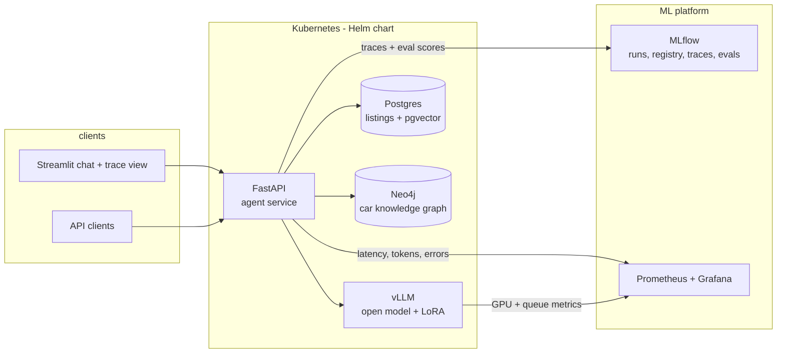

# Roadmap

Where this is going and in what order. Each milestone ends with something a person can open
and look at (a dashboard, a URL, a PR), not just "code exists". Updated as milestones land.

Status: **M0 done** (2026-10-22) · **M1 nearly done** (2026-11-01): full-set baseline pending

## Target architecture

## Stack and why

Few tools, each doing one job. Adding a tool needs an ADR.

| Area | Choice | Why this and not the alternative |
|---|---|---|
| Packaging | **uv** + `uv.lock` | reproducible installs, 5-10x faster CI than pip |
| Agent | **LangGraph** | explicit graph, checkpointing, human-in-the-loop later (ADR 0001) |
| Listings + vectors | **Postgres + pgvector** | one database for structured filters and embeddings; no separate vector DB to run |
| Knowledge graph | **Neo4j** (Community) | makes/models/engines/known issues map naturally to a graph; Cypher queries are easy to read |
| Model serving | **vLLM** | OpenAI-compatible API, so the agent code does not change; serves multiple LoRA adapters |
| Tracking | **MLflow** | one tool for fine-tuning runs, model registry, prompt versions, eval results and agent traces |
| Infra metrics | **Prometheus + Grafana** | standard on Kubernetes; vLLM exports metrics natively |
| Data versioning | **DVC** (remote: S3-compatible / MinIO) | training sets and eval snapshots versioned next to code |
| API / UI | **FastAPI** + **Streamlit** | fast to build; UI is a demo, the API is the product |
| Containers | multi-stage Docker, images on **GHCR** | free for public repos |
| Deploy | **Helm** chart, tested on **kind** in CI | runs on a laptop and in any cloud cluster |
| CD (later) | **Argo CD** (GitOps) | deploy = merge to a config repo |

## Milestones

### M0 - Foundation (done)
Agent with 3 tools, synthetic data, CLAUDE.md, repo self-checks, 13 eval cases, CI.

### M1 - Measured agent (week 2-3)
- [x] Switch to `uv` (dependency groups, `make setup` / `make lock`, uv in CI)
- [x] Commit `uv.lock` so CI installs with `--locked`
- [x] Eval set grown to 56 cases in 9 categories, including multi-step, not-found, vague and
  out-of-scope cases; 13 marked as the smoke set
- [x] Number grounding check on every case: every number in the answer must come from a tool result
- [x] LLM-as-judge for all other claims (opt-in, `--judge`)
- [x] MLflow: every eval run logged with model, prompt/tool/case hashes, metrics and per-case results
- [x] `eval.yml`: smoke set on PRs and on main when the agent changes, full set nightly, gate on a
  drop of more than 5 points against `evals/baseline.json`, issue opened on nightly regression;
  hosted model if `EVAL_API_KEY` is set, otherwise Ollama on the runner's CPU
- [x] Smoke baseline recorded from CI (qwen2.5:7b on CPU: pass 69%, grounded 100%), results and findings in README
- [ ] Full-set baseline from the first nightly run

### M2 - Knowledge integration (week 4-5)
- Move listings to Postgres; SQLite stays for tests
- RAG over car specs and owner reviews (pgvector, hybrid BM25 + vector search, reranker)
- Knowledge graph: make -> model -> generation -> engine -> known issues; `kg_lookup` tool
- Retrieval evals: recall@k and citation accuracy, tracked in MLflow

### M3 - Service and containers (week 6-7)
- FastAPI: `/ask` (streaming), `/health`, `/metrics`
- Streamlit UI with the tool-call trace next to each answer
- Multi-stage Dockerfiles (slim runtime image, non-root user), `docker compose up` for everything
- CI builds images on every PR, scans them with Trivy, pushes to GHCR on main

### M4 - Kubernetes (week 8-9)
- Helm chart: API, Postgres, Neo4j, vLLM (GPU optional, CPU small-model profile for demos)
- HPA on the API; vLLM scaled on queue length
- CI spins up kind, installs the chart, runs smoke tests against it
- Prometheus + Grafana dashboards: latency p50/p95, tokens/s, tool error rate, cost per query

### M5 - Own model (week 10-11)
- Fine-tune a small open model (LoRA) for query -> search filters, on synthetic + hand-labelled
  queries; GPU from Kaggle/Colab
- Compare against prompting a larger model: accuracy, latency, cost. Log both in MLflow
- Register the adapter in the MLflow model registry; vLLM loads it by registry alias
- Promotion rule: new adapter goes live only if eval pass rate >= current

### M6 - Monitoring in production (week 12)
- Every request traced to MLflow (OpenTelemetry)
- Online checks on sampled traffic: hallucinated numbers, unsupported claims, tool failures
- Drift: query mix (fuels, price ranges, languages) vs. eval set; alert when the eval set no
  longer looks like real traffic
- German-language queries supported and evaluated

### M7 - Agents working on the repo (ongoing, from M1)
- Claude Code GitHub Action picks up issues labelled `agent-task`
- `.claude/` with project commands and hooks (run `make check` before finishing)
- Track per agent PR: merged or not, review rounds, what CI caught. Summary table in README
- Write-up: what had to be added to the harness so agents stopped making each mistake

## CI/CD pipeline (end state)

| Trigger | Runs | Blocks merge? |
|---|---|---|
| Every PR | lint, mypy, unit + graph tests, harness checks | yes |
| Every PR | Docker build + Trivy scan, Helm lint | yes |
| PR touching prompts, tools or schemas | eval smoke (15 cases, hosted model) | yes, if pass rate drops |
| Merge to main | push images to GHCR, deploy chart to kind, smoke test | - |
| Nightly | full eval set, retrieval evals, results to MLflow | opens an issue on regression |
| Tag `v*` | release notes, versioned images and chart | - |
| Weekly | Renovate dependency updates, CodeQL | - |

## How progress is tracked

- This file: milestone status, updated when a milestone lands
- GitHub Milestones `M1`...`M7`, one issue per bullet, created with the `agent-task` template
- `CHANGELOG.md` from M1 on, one entry per release
- MLflow: the history of eval pass rate and retrieval scores is the progress chart
